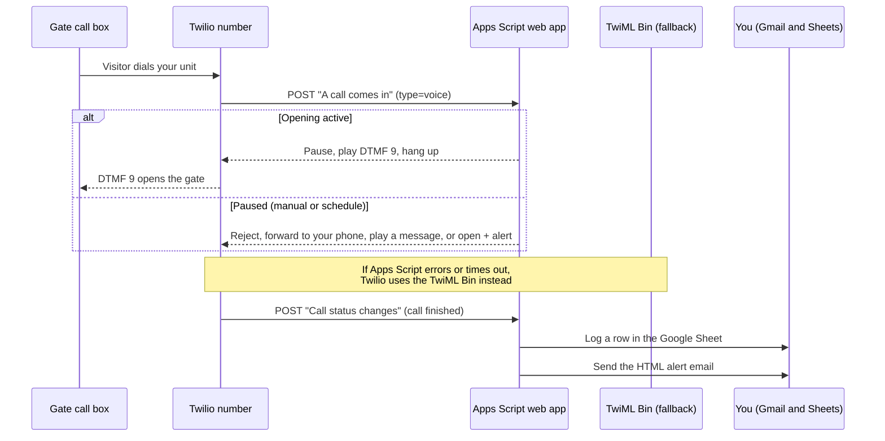
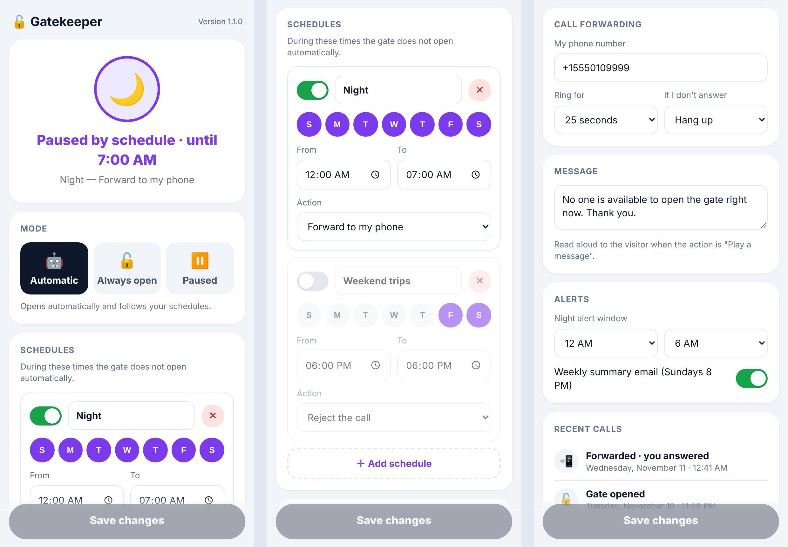
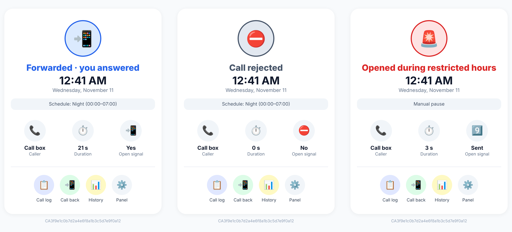

# 🔓 Gatekeeper

 

**Hands-free gate opener with beautiful email alerts — built on Twilio + Google Apps Script.**

Gatekeeper automates access to a **gated community**. The community's call box phones me every time a visitor or delivery arrives, and I had to pick up and press **9** to open the gate. Gatekeeper answers those calls automatically, opens the gate, and emails me a clean card with what happened. It also keeps a call history, sends a weekly summary, and since **v1.1** it has an **admin panel with schedules**. For example, I can keep the gate from opening automatically between midnight and 7 AM and forward those calls to my phone.

It costs about **$0.01 per call** on Twilio. Everything else runs free on Google.

> [!WARNING]
> **Use at your own risk.** Gatekeeper opens your gate for **anyone** who dials your unit from the call box. You only find out **when** the gate opened, not **who** came in. It's very convenient for family use, but read the [disclaimer](#%EF%B8%8F-disclaimer) before you set it up.

---

## ✨ Features

| | Feature | What it does |
|---|---|---|
| 🔓 | **Auto-open** | Answers the call box, waits 1 second, plays DTMF `9`, hangs up. |
| 📧 | **Email after every call** | Card-style HTML email: time, caller, duration and whether the open signal was sent. |
| ❌ | **Failure alert** | Red email if the call failed or dropped before the `9` was sent. |
| 🌙 | **Night alert** | Purple email when the gate opens between 12 AM and 6 AM. |
| ⚠️ | **Unknown caller** | Orange email if the call didn't come from your call box number. |
| 📊 | **Call history** | Every call is logged as a row in a Google Sheet. |
| 📅 | **Weekly summary** | Sunday 8 PM email: openings, failures, night openings, peak hour, busiest day. |
| 🗓️ | **Schedules** *(v1.1)* | Block auto-opening on chosen days and hours, including overnight ranges like 22:00 → 06:00. |
| 🎛️ | **Pause actions** *(v1.1)* | When paused, choose what calls do: **reject**, **forward to your phone** (and if you don't answer, hang up or open anyway), **play a message**, or **open anyway with an urgent alert**. |
| 📱 | **Admin panel** *(v1.1)* | Mobile web app, **only you** can open it (Google sign-in). Modes: Automatic / Always open / Paused. Edit schedules, forwarding and alerts, and see recent calls. |
| 🌐 | **English / Spanish** *(v1.1)* | Set `LANG = 'en'` or `'es'`. |
| 🛟 | **Fail-safe** | If Google is unreachable, Twilio falls back to a static TwiML Bin, so the gate keeps opening. |

---

## 🧭 How it works

---

## 📱 Admin panel (v1.1)

New alert types for the v1.1 actions: forwarded call, rejected call, and opened during restricted hours:

---

## 📸 More screenshots

<table>
<tr>
<td width="50%" valign="top">

**Weekly summary** 

</td>
<td width="50%" valign="top">

**Pause / resume page** (opened from the ⏸️ button) 

</td>
</tr>
</table>

> All screenshots use sample data.

---

## 🚀 Setup (about 15 minutes)

### What you need
- A **Twilio** account with a voice-capable phone number. This is the number your gate call box dials.
- A **Google** account (Gmail + Apps Script, both free).
- The **phone number your call box calls from**, and the **digit** that opens your gate (usually `9`).

### 1. Create the fallback TwiML Bin
In Twilio Console → **TwiML Bins** → *Create*, paste [`twilio/gate-auto-answer.xml`](twilio/gate-auto-answer.xml) and save it as `Gate Auto-Answer`.

### 2. Create the Apps Script project
1. Go to [script.google.com](https://script.google.com) → **New project**.
2. Replace the contents of `Code.gs` with [`src/Code.gs`](src/Code.gs).
3. Edit the **CONFIGURATION** block at the top:

   | Constant | Example | Notes |
   |---|---|---|
   | `EMAIL` | `you@example.com` | Where alerts go. |
   | `TOKEN` | a long random string | A secret that protects your URLs. Generate one with `openssl rand -hex 16`. |
   | `ACCOUNT_SID` | `AC…` | Twilio Console → Account info. |
   | `CALL_BOX` | `+15550100123` | The number your call box calls from, in E.164 format. |
   | `OPEN_DIGIT` | `9` | The digit your gate expects. |
   | `LANG` | `en` | `en` or `es`, for emails, the panel and spoken messages. |
   | `TZ` | `America/New_York` | Your time zone. |

4. Select the `setup` function and click **Run**. Approve the permissions. Google will warn that the app is unverified; that's expected for your own script (*Advanced → Go to project*).
   This creates the **Gatekeeper · Call history** sheet and the Sunday summary trigger.

### 3. Deploy as a web app
**Deploy → New deployment → Web app**
- *Execute as:* **Me**
- *Who has access:* **Anyone**. Twilio needs to reach it. Requests without your `TOKEN` and `ACCOUNT_SID` are rejected.

Copy the `/exec` URL, paste it into `WEB_URL` in the config, save, then **Deploy → Manage deployments → Edit → New version**. The URL stays the same.

### 3b. Deploy the admin panel *(v1.1)*
**Deploy → New deployment → Web app**, with *Execute as:* **Me** and *Who has access:* **Only myself**.
Open that URL on your phone and add it to your home screen. Only your Google account can open it, and Gatekeeper remembers the URL so the ⚙️ button in every email links to it.

> When you change the code later, update **both** deployments to the new version (Manage deployments → Edit → Version).

### 4. Wire up your Twilio number
Twilio Console → **Phone Numbers → Active numbers → (your number) → Voice configuration**:

| Field | Value |
|---|---|
| **A call comes in** | Webhook → `https://script.google.com/macros/s/…/exec?k=YOUR_TOKEN&type=voice` (HTTP POST) |
| **Primary handler fails** | TwiML Bin → `Gate Auto-Answer` |
| **Call status changes** | `https://script.google.com/macros/s/…/exec?k=YOUR_TOKEN` (HTTP POST) |

Save, then call your Twilio number from the call box (or any phone) to test.

> 💡 **Just want the email alerts?** Leave *A call comes in* pointing at your existing TwiML Bin and only set *Call status changes*. You'll get every alert, but schedules and pause actions won't apply.

> 📞 **Forwarding** uses Twilio `<Dial>`, which bills the outgoing leg at standard voice rates (about $0.01–0.02/min in the US). The call box's number shows as the caller ID, and you can press **9** on your phone to let the visitor in.

---

## 🔐 Security notes

- **Treat `TOKEN` like a password.** Anyone who has it can pause your gate. Never commit your real config. Rotate it by changing the constant, redeploying, and updating the two Twilio URLs.
- Requests must include both the token and your Twilio `AccountSid`. Anything else gets `forbidden`.
- The **admin panel** only works for the script owner: it checks your Google identity on every request, and the panel deployment is set to *Only myself*. Strangers get a plain "Access denied".
- The token-only pause page from v1.0 still works as a quick fallback. It opens a confirmation page first, so email link scanners can't toggle it by accident.
- Fail-open by design: if the script is down, the TwiML Bin keeps opening the gate exactly as before.

---

## 🛠️ Customizing

- **Schedules, pause actions, forwarding, message, night window, weekly summary:** all in the admin panel, no code changes
- **Summary day/time:** edit the trigger in `setup()` (default Sunday 8 PM), then run `setup()` again
- **Look & feel:** the `stat`, `roundButton`, `header` and `card` helpers build the emails, using inline CSS for Gmail and iOS Mail
- **Test the summary:** run `testSummary()` from the editor

---

## 🆕 Changelog

See [CHANGELOG.md](CHANGELOG.md). **Upgrading from v1.0:** paste the new `Code.gs`, keep your config values, run `setup()` once (it migrates your pause state and trigger), update your webhook deployment to the new version, and create the panel deployment (step 3b). Your Twilio URLs don't change.

---

## ⚠️ Disclaimer

Gatekeeper is a **personal project**, shared freely so others can learn from it and adapt it. Please understand the risks before using it:

- **It can be dangerous.** While it's active, *anyone* who reaches your unit on the call box gets in: visitors, delivery drivers, or a stranger who simply tries your number.
- **You don't know who enters.** Gatekeeper tells you the date and time the gate opened and which number called. It cannot identify the person at the gate.
- **"Open anyway" options** (*Always open* mode, *Open anyway + alert*, and *If I don't answer → open the gate anyway*) keep the gate opening even when you're not around. Use them knowingly.
- **It's best for family or household use**, where the convenience of not having to answer every call outweighs the risk. Use the ⏸️ pause button when you're away or don't expect anyone.
- **Check your community's rules.** Some HOAs or property managers don't allow automated gate access.
- **Use at your own risk.** The author(s) take **no responsibility** for misuse of this project, unauthorized access, property loss, or any other damage resulting from its use. The software is provided "as is", without warranty of any kind (see [LICENSE](LICENSE)).

Gatekeeper is free to use, modify and share. Using it is your decision and your responsibility.

---

## 📄 License

[MIT](LICENSE)
